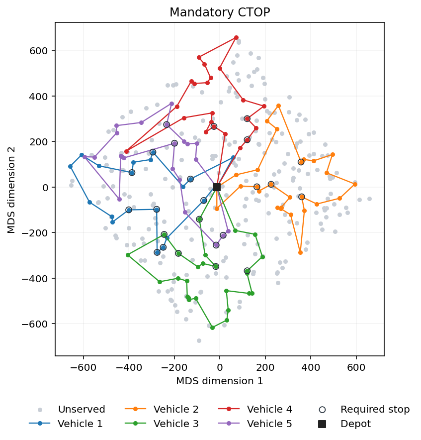
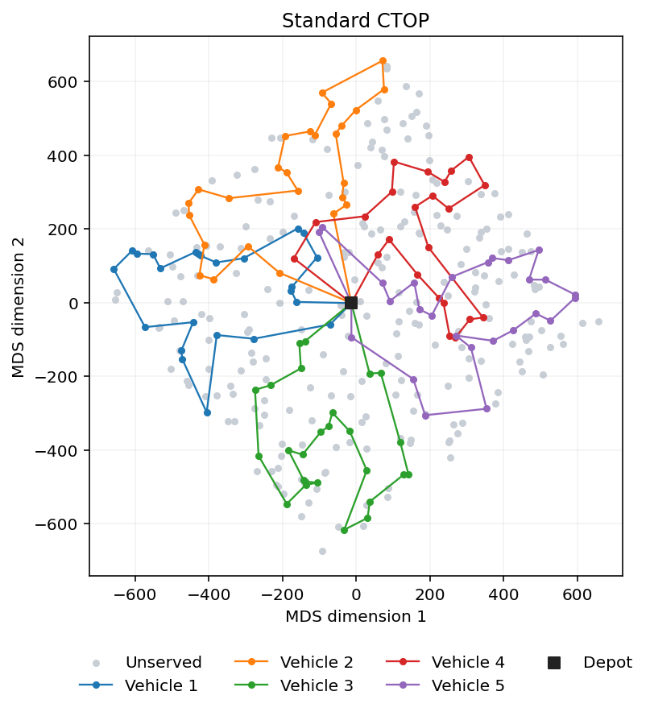

# Capacitated Team Orienteering for Last-Mile Delivery

Given a fleet that cannot serve every customer within one shift, which stops should it serve, and in what order? This project solves two variants of that routing problem on the same instance of **350 customers and 5 vehicles**.

[Read the full assignment brief (PDF, in Greek)](docs/assignment.pdf)

## Results

| Scenario | Collected profit | Total route time | Vehicles used | Validator |
| --- | ---: | ---: | ---: | --- |
| Mandatory CTOP | 7,690 | 11,999.1 | 5 / 5 | Passed |
| Standard CTOP | 8,579 | 11,395.3 | 5 / 5 | Passed |

Both results are heuristic solutions for the supplied instance. Route time is the sum across vehicles, in the units of the input matrix.

| Mandatory CTOP | Standard CTOP |
| --- | --- |
|  |  |
| [Route file](results/solution_mandatory.txt) · [Full-size plot](results/routes_mandatory.png) | [Route file](results/solution_no_mandatory.txt) · [Full-size plot](results/routes_no_mandatory.png) |

Both Matplotlib figures share a two-dimensional multidimensional scaling (MDS) embedding of the input distance matrix. The square marks the depot, each colour represents a vehicle, and grey points are unserved customers. Rings identify required stops in the mandatory scenario. The coordinates are inferred from pairwise costs. Feasibility and reported times use the original matrix.

## Problem

The objective is to maximise the total profit of the customers served, with lower total route time preferred when profit is tied. Each route starts and ends at depot 0, and each customer can be served at most once. A vehicle can carry up to 130 units of demand and its full route must take at most 2,529.2 time units.

**Standard CTOP** treats every customer as optional. **Mandatory CTOP** additionally requires all customers flagged in the instance to appear in the solution.

## Methodology

### Mandatory CTOP

1. **Cluster required stops.** Select geographically spread centres using farthest-first selection in the input cost matrix, then assign each required customer to its closest centre. Each cluster seeds one vehicle route. The construction looks for the insertion position with the smallest added travel time under the route limits.
2. **Add optional stops.** Greedy insertion fills the remaining capacity and time with optional customers, considering profit and insertion cost. Repeated construction creates alternative starting solutions.
3. **Explore between solutions.** An elite set retains strong candidates. Path relinking explores intermediate solutions between candidates, with local search refining the routes.
4. **Perturb and repair.** Iterated local search runs for 500 iterations, using perturbations such as double-bridge moves and route rebuilding. Repair attempts to reinsert missing required customers. Candidates that still omit a required customer after repair are rejected. A final local search refines the solution, and the shared validator checks required-stop coverage and the route constraints.

### Standard CTOP

1. **Construct 30 starting solutions.** A randomised greedy heuristic builds routes by ranking feasible insertions with the score below. It uses lists of the 100 nearest neighbours to limit the candidate search.
2. **Improve the best start.** A remove-and-reinsert pass frees capacity used by lower-value customers and searches for more profitable combinations.
3. **Run destroy-and-repair with simulated annealing.** Across 100 iterations, remove between one and seven customers from selected routes, then rebuild with feasible insertions. Simulated annealing can accept a worse candidate to escape a local optimum. Logarithmic cooling reduces that probability over time.
4. **Polish the routes.** Variable neighbourhood descent applies 2-opt, relocation and swap moves within and between routes. Reducing travel time can create room for more profitable stops, so the solver alternates route improvement with another insertion pass, up to five times.

#### How the insertion score is built

Inserting customer $j$ between consecutive stops $a$ and $b$ replaces the direct leg $a \to b$ with two legs. The added route time is

```math
\Delta t_{a,j,b} = c_{aj} + c_{jb} - c_{ab}.
```

An insertion consumes two resources, vehicle capacity and route time. To combine them, we divide the customer's demand $d_j$ by the mean demand $\bar d$ across all customers, and divide its added time by the mean cost $\bar c$ across all distinct pairs of nodes, including the depot. These ratios are dimensionless. A value of 1 means the insertion uses one average customer's demand or adds the time of one average leg, respectively.

For a feasible insertion with a positive denominator, the score is

```math
S(j \mid a,b) = \frac{p_j}{0.8\,d_j/\bar d + 0.2\,\Delta t_{a,j,b}/\bar c} + 20\,\mathbf{1}_{\{d_j=1\}}.
```

Here $S(j \mid a,b)$ is the insertion score. The numerator $p_j$ is the profit collected by serving $j$. The fraction measures profit per unit of weighted resource use. The 0.8 and 0.2 weights give normalised demand four times the weight of normalised added time, so the ranking favours profitable stops that use less vehicle capacity. The indicator equals 1 for a customer with demand exactly 1 and 0 otherwise. This adds 20 points to the ranking for the smallest loads and leaves the collected profit $p_j$ unchanged.

At each step, the heuristic keeps the highest-scoring feasible insertion for each route and samples uniformly from up to five of those candidates. Repeating the construction 30 times explores different customer selections and route sequences. The best start is selected by collected profit, with lower total route time breaking ties.

## Reproduce the results

With Python 3.12, run from the repository root.

```bash
python -m pip install -r requirements.txt
python Main.py
```

The command solves both scenarios, validates the routes and writes the two route files and two PNGs to `results/`. Each route file contains one depot-to-depot sequence per line. Use `python Main.py --output-dir reproduced` to write a fresh set of outputs without overwriting the examples. The console reports collected profit, total route time, fleet usage and solver runtime for each scenario.

## Repository layout

| Path | Role |
| --- | --- |
| `Main.py` | Runs, validates and exports both scenarios |
| `mandatory/` | Mandatory construction, path relinking and local search |
| `no_mandatory/` | Standard construction, destroy-and-repair and route operators |
| `ctop/` | Shared input parser, solution validator and Matplotlib plotting |
| `data/` | CTOP instance with profits, demands, mandatory flags and costs |
| `results/` | Validated route files and their plots |
| `docs/` | Assignment brief |
